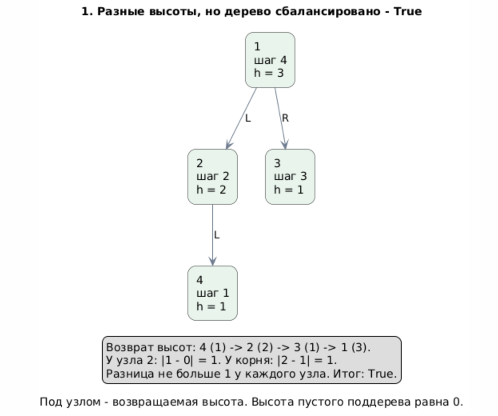
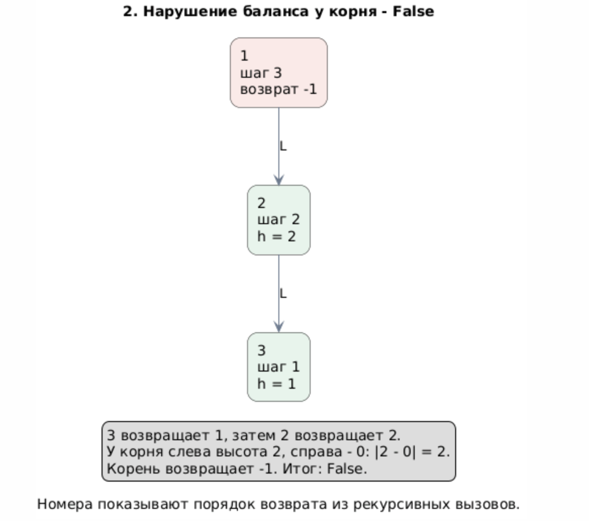
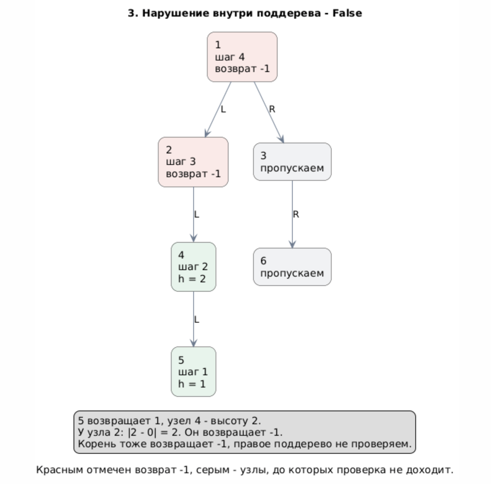

# Balanced Binary Tree

## Объяснение решения

Решение сделано через функцию `is_balanced`. Функция получает корень бинарного дерева `root`, возвращает `True`, если для каждого узла высоты левого и правого поддеревьев отличаются не больше чем на 1, иначе — `False`.

Для узлов используем класс `Node` со значением `value` и ссылками `left`, `right`. Значения узлов на баланс не влияют: проверяем структуру дерева, оно не обязано быть BST.

### Как работает функция

- Создаём вложенную функцию `height(node)`. Она возвращает высоту сбалансированного поддерева или `-1`, если найдено нарушение баланса.
- Для `None` возвращаем высоту 0.
- Рекурсивно получаем высоту левого поддерева. Если она равна `-1`, сразу возвращаем `-1`.
- Аналогично проверяем правое поддерево.
- Если `abs(left_height - right_height) > 1`, возвращаем `-1`.
- Иначе возвращаем `max(left_height, right_height) + 1`.
- В основной функции проверяем `height(root) != -1`.

Высоты вычисляем снизу вверх. Для каждого узла оба поддерева уже проверены, остаётся сравнить их высоты. Если одно из них несбалансировано, передаём `-1` вверх. Поэтому нарушение в любой части дерева приводит к `False`. Пустое дерево считается сбалансированным.

## Оценка сложности

**Время — O(n) в худшем случае**, где `n` — количество узлов.

Каждый узел обрабатываем не больше одного раза. Высоту поддерева вычисляем один раз и передаём родителю, повторных обходов для подсчёта высот нет.

**Дополнительная память — O(h)**, где `h` — количество узлов на самом длинном пути от корня до листа.

Стек рекурсии хранит путь до текущего узла. Для дерева логарифмической высоты требуется O(log n), в худшем случае для цепочки — O(n). Для пустого дерева время и память — O(1).

## Визуализация работы

### Пример 1. Разница высот равна 1

Считаем высоты снизу вверх: лист 4 возвращает 1, узел 2 - высоту 2, лист 3 - высоту 1. У корня разница `abs(2 - 1) = 1`, возвращаем высоту 3. У остальных узлов разница также не больше 1.

**Ответ: `True`.** Симметрия дерева не требуется.

### Пример 2. Нарушение у корня

Лист 3 возвращает высоту 1, узел 2 - высоту 2. У корня слева высота 2, справа - 0. Разница равна 2, поэтому корень возвращает `-1`.

**Ответ: `False`.**

### Пример 3. Нарушение внутри поддерева

1. Спускаемся по пути 1 -> 2 -> 4 -> 5. Лист 5 возвращает высоту 1, узел 4 - высоту 2.
2. У узла 2 слева высота 2, справа - 0. Разница равна 2, возвращаем `-1`.
3. Корень получает `-1` от левого поддерева и тоже возвращает `-1`. Правое поддерево уже не обходим.

**Ответ: `False`.** Высоты поддеревьев корня отличаются только на 1, но внутри левого поддерева есть нарушение.