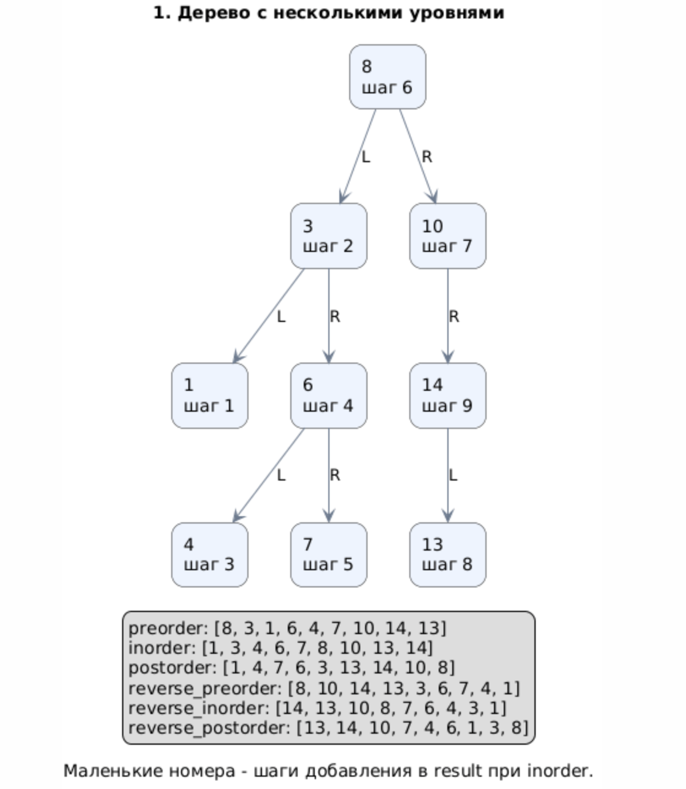
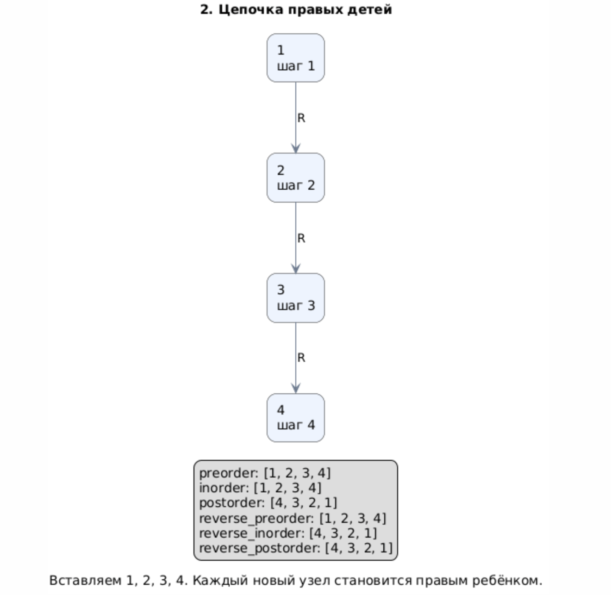
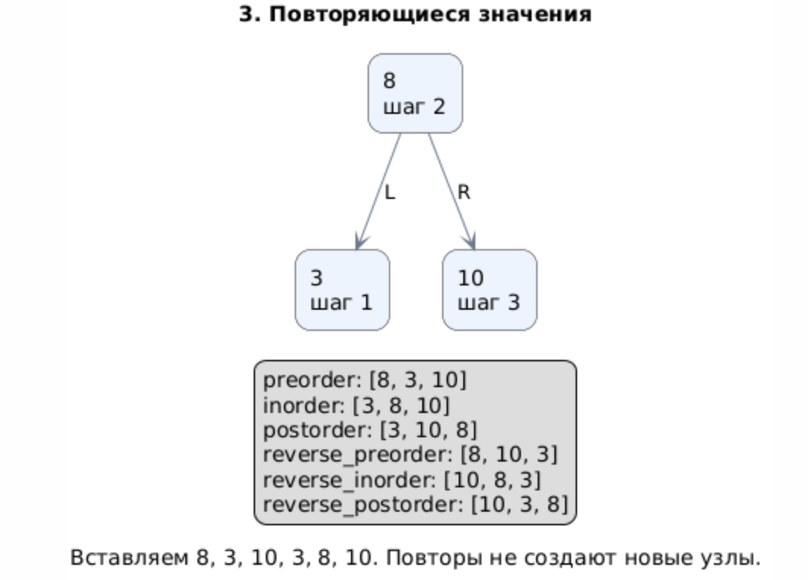

# Tree Traversal

## Объяснение решения

Решение сделано через классы `Node` и `BST`.

Для узлов дерева создан класс `Node`: в `value` храним значение, а в `left` и `right` — ссылки на левого и правого ребёнка. Если ребёнка нет, соответствующая ссылка равна `None`.

В `BST` храним корень дерева `root`. При создании дерево пустое, поэтому `root = None`. В левом поддереве каждого узла находятся меньшие значения, в правом — большие. Повторяющиеся значения не добавляем.

### Вставка — insert(value)

- Если дерево пустое, создаём узел `Node(value)` и записываем его в `self.root`.
- Иначе начинаем с корня: `current = self.root`.
- Если `value < current.value`, переходим к левому ребёнку. Если его нет, создаём его и завершаем вставку.
- Если `value > current.value`, аналогично переходим к правому ребёнку или создаём его.
- Если значения равны, завершаем метод без добавления узла.

На каждом шаге выбираем поддерево, в котором может находиться новое значение. Учитываем сравнения со всеми узлами на пути, поэтому вставка сохраняет свойства BST.

### Обходы дерева

- Создаём пустой список `result` и вложенную функцию `traverse(node)`.
- Если `node is None`, завершаем текущий вызов.
- Иначе рекурсивно обходим поддеревья и добавляем значение текущего узла через `result.append(node.value)`. Порядок действий зависит от метода.
- Запускаем обход от корня: `traverse(self.root)`.
- Возвращаем `result`.

Порядок действий для каждого метода:

- `preorder`: узел -> левое поддерево -> правое поддерево.
- `inorder`: левое поддерево -> узел -> правое поддерево.
- `postorder`: левое поддерево -> правое поддерево -> узел.
- `reverse_preorder`: узел -> правое поддерево -> левое поддерево.
- `reverse_inorder`: правое поддерево -> узел -> левое поддерево.
- `reverse_postorder`: правое поддерево -> левое поддерево -> узел.

Каждый узел добавляем в список один раз, оба его поддерева также обходим. Поэтому все значения попадают в результат в заданном порядке. Для пустого дерева возвращаем `[]`.

Т.к. в BST слева находятся меньшие значения, а справа — большие, `inorder` возвращает значения по возрастанию, а `reverse_inorder` — по убыванию.

## Оценка сложности

Пусть `n` — количество узлов дерева, а `h` — количество узлов на самом длинном пути от корня до листа.

### Вставка

**Время — O(h).**

Проходим один путь от корня до места вставки. При логарифмической высоте дерева время — O(log n). В худшем случае дерево превращается в цепочку, и вставка занимает O(n). Для пустого дерева — O(1).

**Дополнительная память — O(1).**

Используем цикл и фиксированное количество переменных. При успешной вставке создаём один новый узел. Хранение всего дерева требует O(n) памяти.

### Каждый обход

**Время — O(n).**

Каждый узел обрабатываем один раз. Добавление в конец списка занимает O(1) амортизированно, поэтому суммарное время линейно.

**Дополнительная память — O(h) без учёта результата, O(n) с учётом результата.**

Стек рекурсивных вызовов хранит путь до текущего узла. При логарифмической высоте он занимает O(log n), для цепочки — O(n). В списке результата храним n значений, поэтому вместе требуется O(n + h) = O(n) памяти. Для пустого дерева время и память — O(1).

## Визуализация работы

### Пример 1. Дерево с несколькими уровнями

Вставляем `[8, 3, 10, 1, 6, 14, 4, 7, 13]`. При вставке 4 проходим 8 -> 3 -> 6 и создаём левого ребёнка узла 6.

При `inorder` сначала добавляем 1 и 3, затем обходим поддерево 6: добавляем 4, 6, 7. Возвращаемся к 8 и обходим правую часть: 10, 13, 14. Номера возле узлов показывают эти шаги. На схеме также приведены результаты остальных обходов.

### Пример 2. Дерево в виде цепочки

Вставляем `[1, 2, 3, 4]`. Все новые значения больше предыдущих, поэтому каждый узел становится правым ребёнком.

`Preorder` и `inorder` добавляют значения от корня к листу. В `postorder` сначала доходим до 4, затем при возврате добавляем 3, 2, 1. Результаты обратных обходов указаны на схеме.

### Пример 3. Повторяющиеся значения

Вставляем `[8, 3, 10, 3, 8, 10]`. При повторной вставке 3 доходим до узла 3, видим равенство и завершаем метод. Аналогично пропускаем повторные 8 и 10.

В дереве остаются три узла, каждый обход возвращает три значения.