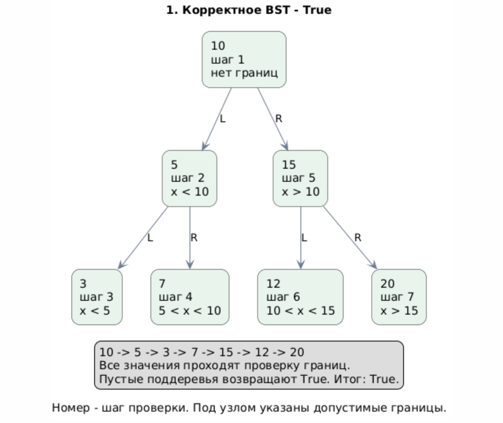
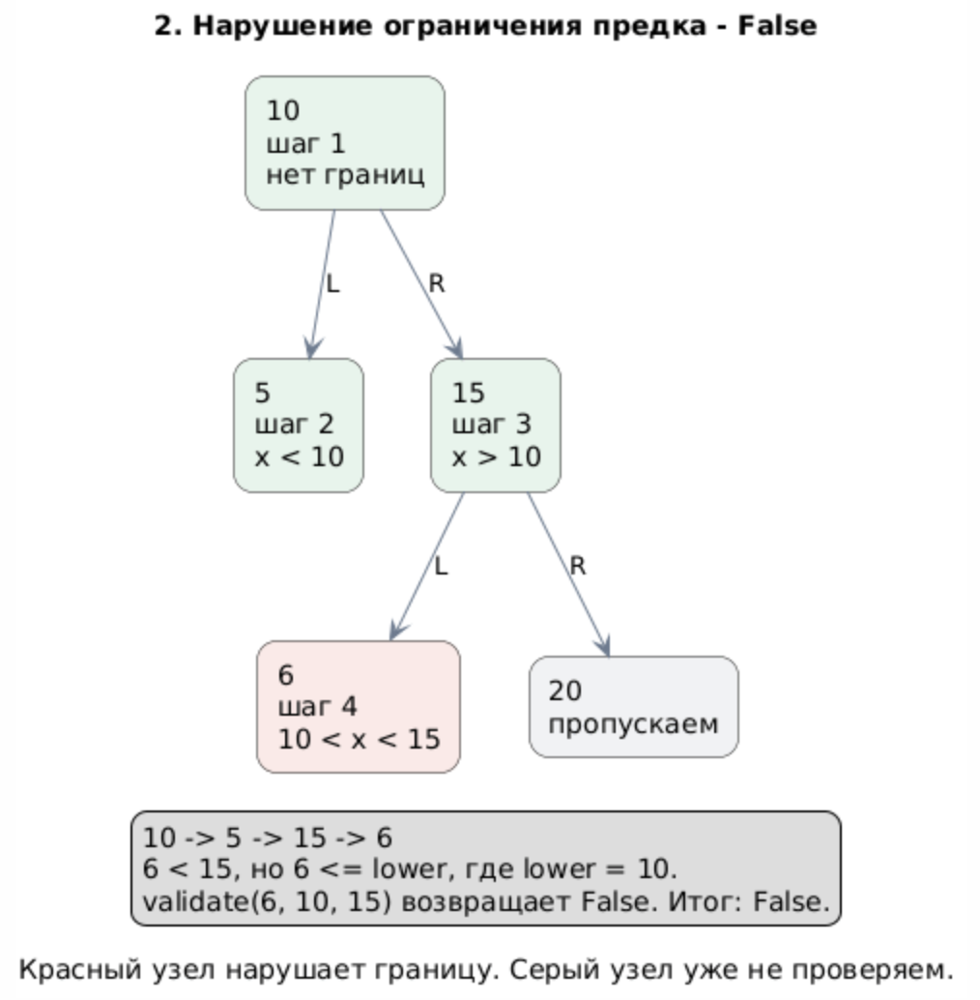
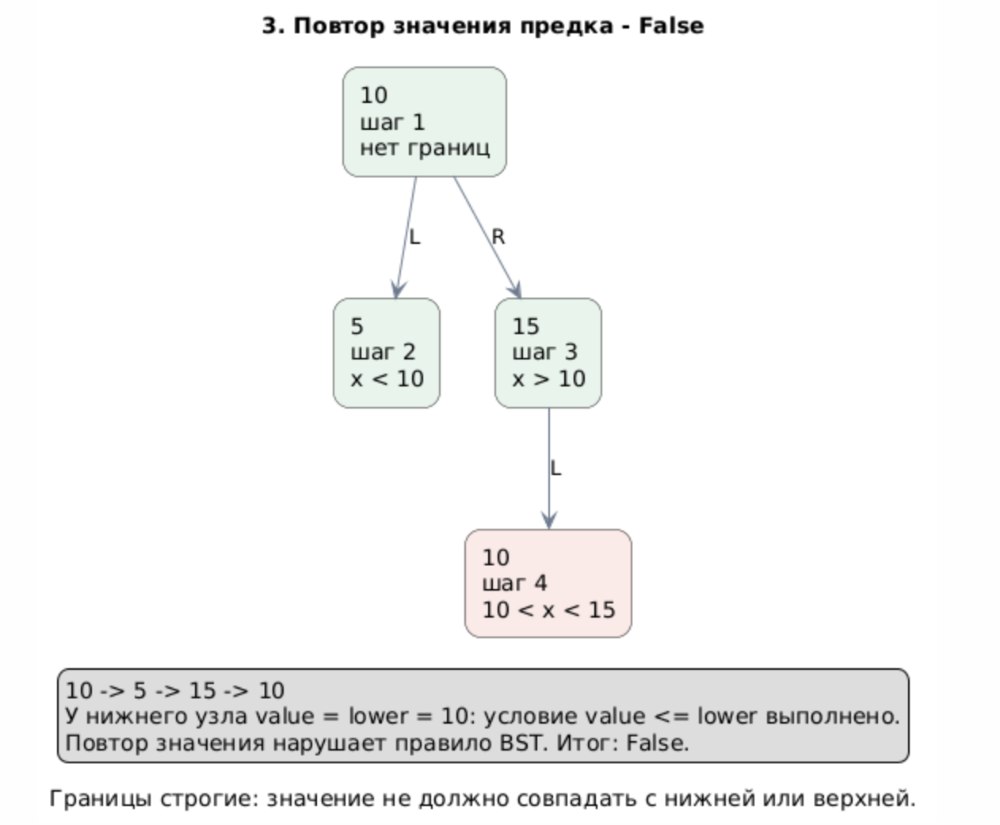

# Validate BST

## Объяснение решения

Решение сделано через функцию `is_valid_bst`. Функция получает корень бинарного дерева `root`, возвращает `True`, если дерево является BST, иначе — `False`.

Для узлов используем класс `Node`: в `value` храним значение, в `left` и `right` — ссылки на детей. В левом поддереве каждого узла все значения должны быть меньше его значения, в правом — больше. Повторы считаем нарушением.

### Как работает функция

- Создаём вложенную функцию `validate(node, lower, upper)`. Границы задают допустимый интервал для значения узла. `None` означает отсутствие ограничения с этой стороны.
- Если `node is None`, возвращаем `True`: пустое дерево не нарушает правила BST.
- Если нижняя граница задана и `node.value <= lower`, возвращаем `False`.
- Если верхняя граница задана и `node.value >= upper`, также возвращаем `False`.
- Проверяем левое поддерево с границами `lower` и `node.value`, правое — с границами `node.value` и `upper`.
- Возвращаем `True`, только если обе проверки успешны. Начинаем с `validate(root, None, None)`.

Границы сохраняют ограничения всех предков, поэтому проверяем расположение узла во всём дереве, а не только относительно его родителя. При первом нарушении проверка завершается с `False`. Если нарушений нет, каждый узел находится в своём допустимом интервале и дерево является BST.

## Оценка сложности

**Время — O(n) в худшем случае**, где `n` — количество узлов.

Каждый узел проверяем не больше одного раза, выполняя фиксированное количество сравнений. При обнаружении нарушения можем завершить проверку раньше.

**Дополнительная память — O(h)**, где `h` — количество узлов на самом длинном пути от корня до листа.

Стек рекурсии хранит путь до текущего узла. Для дерева логарифмической высоты требуется O(log n), для цепочки в худшем случае — O(n). Для пустого дерева время и память — O(1).

## Визуализация работы

### Пример 1. Корректное BST

Проверяем узлы в порядке 10 -> 5 -> 3 -> 7 -> 15 -> 12 -> 20. Например, для 7 допустим интервал `5 < 7 < 10`, для 12 - `10 < 12 < 15`. Все значения проходят проверку, пустые поддеревья возвращают `True`.

**Ответ: `True`.**

### Пример 2. Нарушение ограничения предка

1. Узлы 10, 5 и 15 проходят проверку границ.
2. Для узла 6 границы - 10 и 15. Хотя 6 меньше родителя 15, условие `10 < 6 < 15` не выполняется.
3. Возвращаем `False` к корню. Узел 20 уже не проверяем.

**Ответ: `False`.**

### Пример 3. Повтор значения предка

В левом поддереве узла 15 находится ещё один узел со значением 10. Нижняя граница для него тоже равна 10, поэтому срабатывает условие `node.value <= lower`. Равенство не допускается.

**Ответ: `False`.**