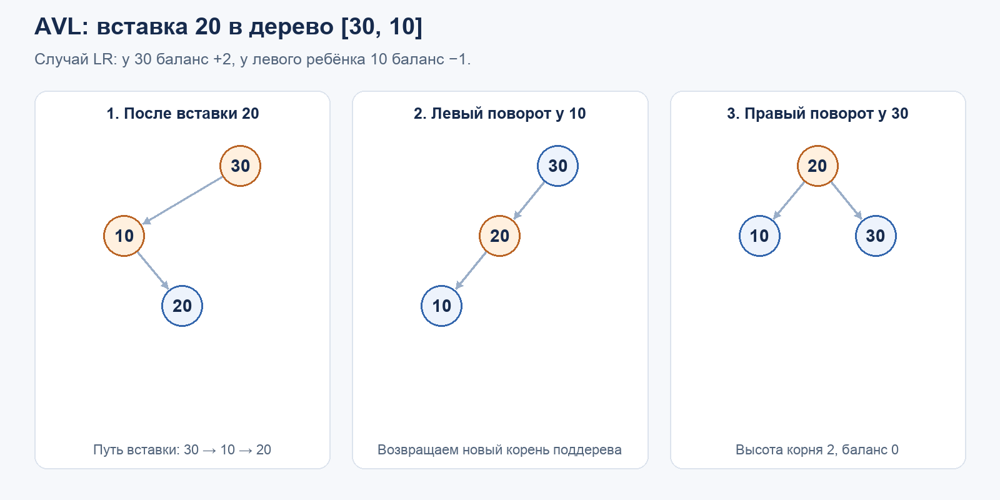
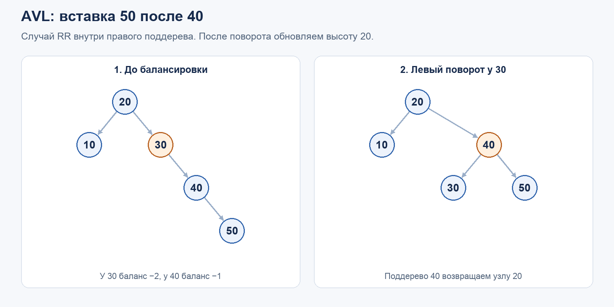
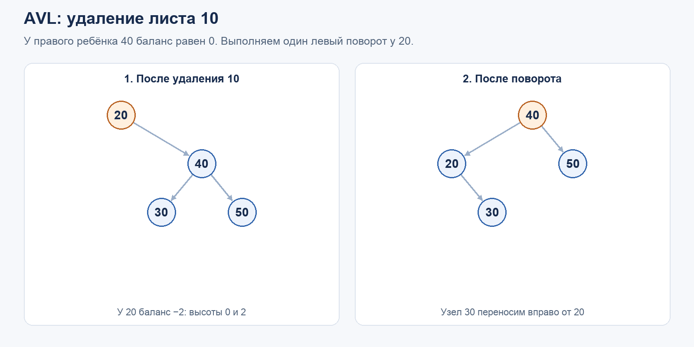
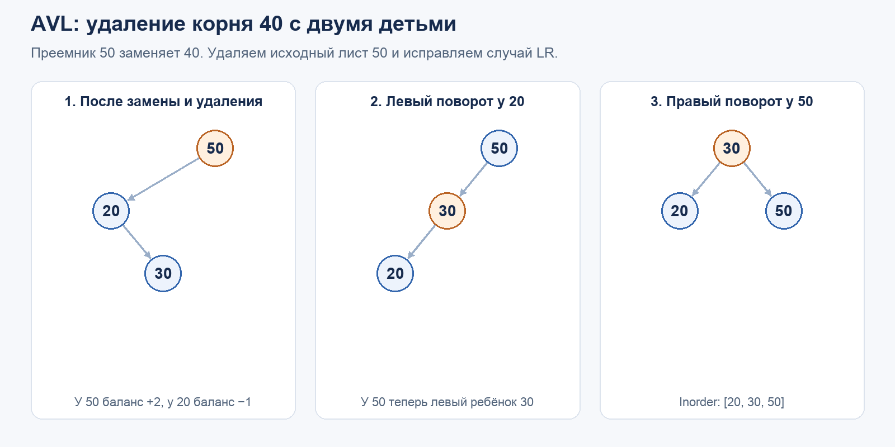

# AVL

## Объяснение решения

Решение сделано через классы `Node` и `AVL`.

Для узлов дерева создан класс `Node`: в `value` храним значение, в `left` и `right` — ссылки на детей, в `height` — высоту поддерева. У листа высота 1, у пустого поддерева — 0.

В `AVL` храним корень `root`. При создании дерево пустое: `root = None`. Как и в BST, слева находятся меньшие значения, справа — большие. Дополнительно для каждого узла разница высот поддеревьев не больше 1.

Повторяющиеся значения не добавляем. `insert(value)` и `delete(value)` меняют дерево и возвращают `None`. Удаление отсутствующего значения ничего не меняет. `search(value)` возвращает `True` или `False`. Значения должны быть сравнимы между собой и иметь полный порядок; например, можно хранить целые числа или строки.

### Высоты и балансировка

- `_height(node)` возвращает сохранённую высоту или 0 для `None`.
- `_update_height(node)` вычисляет `max(height(left), height(right)) + 1`.
- `_balance_factor(node)` возвращает `height(left) - height(right)`.
- `_rebalance(node)` обновляет высоту и при необходимости делает поворот, возвращая новый корень поддерева.

| Нарушение | Условие | Как исправляем |
| --- | --- | --- |
| LL | Баланс узла больше 1, баланс левого ребёнка неотрицательный | Правый поворот |
| LR | Баланс узла больше 1, баланс левого ребёнка отрицательный | Левый поворот ребёнка, затем правый поворот узла |
| RR | Баланс узла меньше -1, баланс правого ребёнка неположительный | Левый поворот |
| RL | Баланс узла меньше -1, баланс правого ребёнка положительный | Правый поворот ребёнка, затем левый поворот узла |

Нулевой баланс тяжёлого ребёнка возможен после удаления: в таком случае тоже нужен одиночный поворот.

При правом повороте левый ребёнок становится новым корнем, прежний корень — его правым ребёнком. Правое поддерево нового корня переносим в левого ребёнка прежнего корня. При левом повороте действия зеркальные. Сначала обновляем высоту прежнего корня, затем нового.

Поворот сохраняет порядок BST. Например, для правого поворота значения перенесённого среднего поддерева больше нового корня и меньше прежнего, поэтому на новом месте они по-прежнему находятся между ними.

### Вставка — insert(value)

- Запускаем `_insert` от корня.
- Если поддерево пустое, создаём `Node(value)`.
- Иначе сравниваем значение с текущим узлом и рекурсивно вставляем в нужное поддерево. При равенстве возвращаем узел без добавления.
- При возврате вызываем `_rebalance` для каждого узла на пути.
- Полученный корень записываем в `self.root`.

Обычная вставка сохраняет порядок BST, а балансировка исправляет изменение высот снизу вверх. Важно сохранять возвращённый корень: после поворота он может измениться и у поддерева, и у всего дерева.

### Удаление — delete(value)

- Запускаем `_delete` от корня и ищем значение по правилу BST.
- Если дошли до `None`, значение отсутствует, возвращаем `None` для этого пустого поддерева.
- Если у найденного узла нет левого ребёнка, возвращаем правого; если нет правого — левого. Так удаляем и лист, и узел с одним ребёнком.
- Если есть оба ребёнка, находим минимальный узел в правом поддереве: идём вправо один раз, затем влево до конца. Копируем его значение в текущий узел и рекурсивно удаляем исходный узел-преемник справа.
- При возврате балансируем все оставшиеся узлы на пути и обновляем `self.root`.

Преемник больше любого значения слева и не больше остальных значений справа, поэтому замена сохраняет порядок BST. После удаления высота поддерева может уменьшиться. Балансировку продолжаем до корня: одного исправления внизу иногда недостаточно.

### Поиск — search(value)

Начинаем с корня. Если искомое значение меньше текущего, идём влево, если больше — вправо. При равенстве возвращаем `True`, при переходе в `None` — `False`. На каждом шаге исключаем поддерево, в котором значения быть не может.

Для проверки результата дополнительно реализован `inorder()`: он возвращает все значения по возрастанию. Для пустого дерева возвращает `[]`.

## Оценка сложности

Пусть `n` — количество узлов дерева, `h` — его высота. Сравнение значений считаем O(1).

В AVL минимальное число узлов для высоты `h` удовлетворяет соотношению `N(h) = 1 + N(h - 1) + N(h - 2)`, где `N(0) = 0`, `N(1) = 1`. Эта последовательность растёт экспоненциально по высоте, поэтому `h = O(log n)`.

| Операция | Время в худшем случае | Дополнительная память |
| --- | --- | --- |
| `insert` | O(log n) | O(log n) |
| `delete` | O(log n) | O(log n) |
| `search` | O(log n) | O(1) |
| `inorder` | O(n) | O(log n) без результата, O(n) с результатом |

При вставке и удалении проходим путь длины O(h), при возврате на каждом уровне обновляем высоту и выполняем не больше двух поворотов. Один поворот занимает O(1): меняем несколько ссылок и две высоты. Поиск преемника при удалении также укладывается в O(h). Стек рекурсии занимает O(h).

Поиск сделан циклом и использует фиксированное количество переменных. `inorder` посещает каждый узел один раз и сохраняет `n` значений.

**Память для хранения дерева — O(n).** Каждый узел содержит значение, две ссылки и высоту. Для операций с пустым деревом время и память — O(1); единственная вставка создаёт один узел. Оценки O(log n) относятся к непустым деревьям с растущим `n`, единообразно можно записать O(log(n + 1)).

## Визуализация работы

### Пример 1. Двойной поворот при вставке

Вставляем `[30, 10, 20]`.



1. После вставки 30 получаем один узел высоты 1.
2. Добавляем 10 слева. Высота 30 становится 2, баланс равен 1 — поворот не нужен.
3. Добавляем 20 справа от 10. У 30 слева высота 2, справа 0: баланс равен 2. У левого ребёнка 10 баланс равен -1, это случай LR.
4. Делаем левый поворот у 10: узел 20 поднимается, 10 становится его левым ребёнком.
5. Делаем правый поворот у 30: корнем становится 20, его дети — 10 и 30. Высоты детей равны 1, высота корня — 2.

**Результат `inorder`: `[10, 20, 30]`.**

### Пример 2. Одиночный поворот внутри дерева

Продолжаем вставкой 40 и 50.



После вставки 40 поворот не нужен. Вставка 50 создаёт цепочку `30 -> 40 -> 50`. У 30 баланс -2, у 40 — -1. Делаем левый поворот у 30 и возвращаем новый корень этого поддерева — 40. Он становится правым ребёнком 20. На схеме слева показано состояние до балансировки.

```text
    20
   /  \
 10    40
      /  \
     30  50
```

**Результат `inorder`: `[10, 20, 30, 40, 50]`.**

### Пример 3. Удаление листа и нулевой баланс ребёнка

Удаляем 10 из предыдущего дерева.



1. Убираем лист 10.
2. У 20 слева высота 0, справа 2, баланс равен -2.
3. У правого ребёнка 40 оба поддерева высоты 1, его баланс равен 0.
4. Делаем один левый поворот у 20. Среднее поддерево, узел 30, переносим в правого ребёнка 20.

Получаем корень 40 высоты 3, слева — 20 с правым ребёнком 30, справа — 50. Все балансы находятся в диапазоне от -1 до 1.

### Пример 4. Удаление узла с двумя детьми

Удаляем 40 из полученного дерева.



1. У 40 два ребёнка. Минимальное значение справа — 50, заменяем 40 на 50 и удаляем исходный лист 50.
2. Временно получаем корень 50 с левым ребёнком 20, у которого справа 30. Баланс корня равен 2, баланс левого ребёнка равен -1.
3. Делаем левый поворот у 20, затем правый поворот у 50.

**Результат: корень 30, дети 20 и 50; `inorder` возвращает `[20, 30, 50]`.**

### Пример 5. Поиск

В итоговом дереве ищем 50 и отсутствующее значение 40.

| Запрос | Шаг 1 | Шаг 2 | Шаг 3 | Ответ |
| --- | --- | --- | --- | --- |
| `search(50)` | `50 > 30`, идём вправо | Найден узел 50 | — | `True` |
| `search(40)` | `40 > 30`, идём вправо | `40 < 50`, идём влево | Получаем `None` | `False` |
