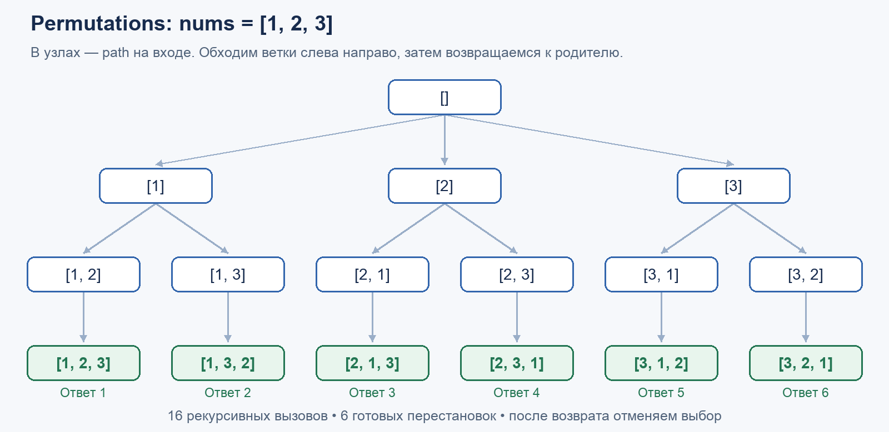

# Permutations

## Объяснение решения

Решение сделано через функцию `permutations(nums, trace=True)`. Она получает список целых чисел и возвращает список всех различных перестановок. Исходный список не меняем.

Используем рекурсивный перебор с возвратом: выбираем очередное значение, продолжаем строить перестановку, затем отменяем выбор и пробуем следующее значение.

Для визуализации используем тот же декоратор `tracer`, что и в первой задаче. Его код находится в этом файле, поэтому решение можно запускать отдельно.

В `counts` храним, сколько экземпляров каждого значения осталось. В `path` — текущую перестановку, в `result` — готовые ответы. Порядок выбора соответствует первому появлению значений во входном списке.

### Как работает функция

- Подсчитываем количество каждого значения в `counts`.
- Создаём вложенную функцию `backtrack(path)`.
- Если длина `path` равна длине `nums`, добавляем `path.copy()` в результат и завершаем вызов. Копия нужна, т.к. сам `path` продолжит меняться.
- Иначе перебираем значения из `counts`. Если доступных экземпляров нет, пропускаем значение.
- Добавляем выбранное значение в `path`, уменьшаем его счётчик и вызываем `backtrack(path)`.
- После возврата увеличиваем счётчик обратно и удаляем последний элемент через `path.pop()`.
- Если `trace=True`, оборачиваем `backtrack` декоратором `tracer` из первой задачи. Имя `backtrack` теперь указывает на обёртку, поэтому рекурсивные вызовы тоже выводятся.
- Запускаем `backtrack([])` и возвращаем `result`.

В каждой ветке используем только доступные экземпляры значений. На глубине `n` получаем перестановку всех элементов. Для любого допустимого следующего значения создаём ветку, поэтому перебираем все возможные ответы. Отмена выбора восстанавливает состояние перед соседней веткой.

Повторяющиеся значения представлены одним ключом с количеством, поэтому одинаковые перестановки не создаём. Например, для `[1, 1, 2]` получаем `[[1, 1, 2], [1, 2, 1], [2, 1, 1]]`. Для пустого списка возвращаем `[[]]`: существует одна перестановка из нуля элементов.

`backtrack` возвращает `None`: готовые перестановки он добавляет в общий `result`. Поэтому в трассировке возврат записан как `<- backtrack = None`. Состояние текущего пути видно на входе в каждый вызов, а итоговый список возвращает `permutations`.

## Оценка сложности

Пусть `n` — длина списка. Сравнение, хеширование и представление одного числа считаем O(1). Операции со словарём в среднем занимают O(1).

**Время — O(n · n!) для различных элементов при обычной работе словаря.**

Всего есть `n!` перестановок длины `n`. Копирование готовых ответов требует O(n · n!). В дереве перебора O(n!) вызовов, в каждом внутреннем вызове перебираем `n` значений, поэтому эта часть также укладывается в O(n · n!).

Трассировка печатает вход и возврат для каждого вызова. Длина строки с путём и отступом — до O(n), поэтому для различных элементов оценка остаётся O(n · n!).

В худшем случае из-за хеш-коллизий обращение к словарю занимает O(n), тогда верхняя оценка времени — O(n² · n!).

**Дополнительная память без результата — O(n).**

В стеке одновременно не больше `n + 1` рекурсивных вызовов. Используем один общий `path` и словарь `counts`, каждый размером до `n` элементов. Обёртки декоратора и текущая строка вывода также требуют O(n) памяти.

**Память с результатом — O(n · n!).**

Сохраняем `n!` отдельных списков длины `n`. Вывод отправляем в консоль и в решении не накапливаем.

При повторах готовых перестановок меньше. Например, если все значения одинаковые, получаем один ответ: без трассировки время O(n), с трассировкой — O(n²) из-за растущих путей и отступов. Для пустого списка время и память — O(1).

## Визуализация работы

### Пример 1. nums = [1, 2, 3]



На схеме показаны значения `path` на входе в рекурсивные вызовы. Слева направо идут ветки в порядке обхода, в листьях — готовые ответы.

| Шаг | Действие | path | Оставшиеся значения |
| --- | --- | --- | --- |
| 1 | Начинаем перебор | `[]` | `1, 2, 3` |
| 2 | Выбираем 1 | `[1]` | `2, 3` |
| 3 | Выбираем 2 | `[1, 2]` | `3` |
| 4 | Выбираем 3, сохраняем копию | `[1, 2, 3]` | нет |
| 5 | Возвращаем 3, затем 2 | `[1]` | `2, 3` |
| 6 | Выбираем 3 | `[1, 3]` | `2` |
| 7 | Выбираем 2, сохраняем копию | `[1, 3, 2]` | нет |
| 8 | Возвращаемся к пустому пути | `[]` | `1, 2, 3` |
| 9 | Аналогично обходим ветки с 2 и 3 | `[2]`, затем `[3]` | зависят от пути |

Начало вывода реализации:

```text
-> backtrack([])
  -> backtrack([1])
    -> backtrack([1, 2])
      -> backtrack([1, 2, 3])
      <- backtrack = None
    <- backtrack = None
    -> backtrack([1, 3])
      -> backtrack([1, 3, 2])
      <- backtrack = None
    <- backtrack = None
  <- backtrack = None
```

Дальше на той же глубине начинаются ветки `[2]` и `[3]`. Всего выполняется 16 вызовов `backtrack`: 1 + 3 + 6 + 6. Каждый вызов имеет строку входа и строку возврата.

**Ответ: `[[1, 2, 3], [1, 3, 2], [2, 1, 3], [2, 3, 1], [3, 1, 2], [3, 2, 1]]`.**

### Пример 2. Повторяющиеся значения

Для `[1, 1, 2]` начальные счётчики — `{1: 2, 2: 1}`.

```text
[]
├── [1]
│   ├── [1, 1] ── [1, 1, 2]
│   └── [1, 2] ── [1, 2, 1]
└── [2]
    └── [2, 1] ── [2, 1, 1]
```

Вторую отдельную ветку с первой единицей не создаём: у значения 1 один ключ в `counts`, доступных экземпляров — два.
