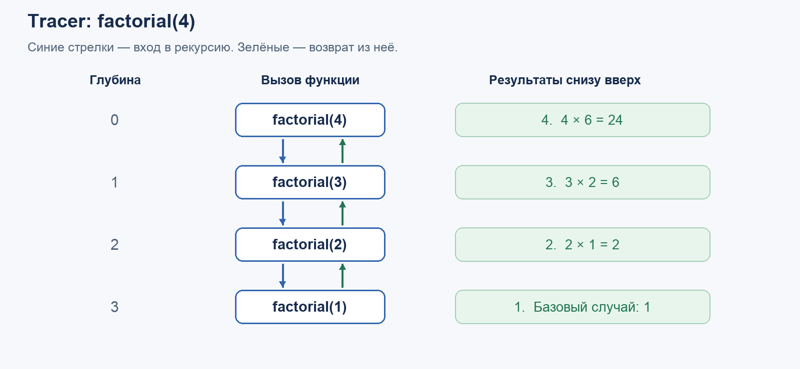

# Tracer

## Объяснение решения

Решение сделано через декоратор `tracer`. Он получает функцию `func`, возвращает обёртку `wrapper` и показывает вход в каждый вызов, его глубину и возврат с результатом.

В замыкании храним счётчик `depth`. У внешнего вызова глубина равна 0, каждый следующий уровень добавляет два пробела.

### Как работает декоратор

- Через `@wraps(func)` сохраняем имя, документацию и аннотации исходной функции.
- В `wrapper(*args, **kwargs)` принимаем позиционные и именованные аргументы. Вспомогательная функция `_format_call` собирает имя функции и аргументы через `repr`, поэтому строки видны с кавычками.
- Перед вызовом печатаем `-> имя(аргументы)` с текущим отступом.
- Увеличиваем `depth` на 1 и вызываем исходную функцию с теми же аргументами.
- При обычном завершении печатаем `<- имя = результат` и возвращаем исходный результат. У входа и возврата одного вызова одинаковый отступ.
- При исключении печатаем `<! имя raises ошибка` и передаём то же исключение дальше через `raise`.
- В `finally` уменьшаем `depth` на 1. Этот блок выполняется и при возврате, и при ошибке, поэтому следующий запуск начинается с правильной глубины.

После `@tracer` имя рекурсивной функции ссылается на обёртку. Поэтому внутренние вызовы тоже проходят через `wrapper`, а не обходят декоратор. Счётчик увеличивается при входе и уменьшается при выходе, что соответствует работе стека.

Декоратор рассчитан на обычные синхронные функции. У каждой декорированной функции собственная глубина: это стек её рекурсивных вызовов.

## Оценка сложности

Пусть `C` — общее количество вызовов, `h` — максимальное количество одновременно активных вызовов, `L` — суммарная длина напечатанного текста, `M` — максимальная длина одной строки.

**Дополнительное время — O(C + L)** при линейной стоимости форматирования и вывода текста.

Для каждого вызова меняем счётчик и печатаем две строки. Сюда входят отступы, представления аргументов и результатов. Саму работу исходной функции считаем отдельно. Если пользовательский `repr` выполняет сложные вычисления, его стоимость также нужно добавить.

**Дополнительная память — O(h + M)** при фиксированном количестве аргументов.

Обёртки находятся в стеке до завершения соответствующих вызовов, а текущую строку формируем перед печатью. Готовые строки в декораторе не накапливаем. Если весь вывод сохранять во внешнем буфере, ему дополнительно потребуется O(L) памяти.

Для цепочки из `h` вызовов с короткими аргументами и результатами только отступы дают O(h²) символов. Поэтому затраты на визуализацию нельзя считать O(1) на вызов независимо от глубины. Общая сложность программы складывается из работы исходного алгоритма и декоратора.

## Визуализация работы

### Пример 1. Факториал 4

```python
@tracer
def factorial(n):
    if n <= 1:
        return 1
    return n * factorial(n - 1)

factorial(4)
```



1. `factorial(4)` ждёт результат `factorial(3)`.
2. Доходим через `factorial(3)` и `factorial(2)` до базового случая `factorial(1)`.
3. Базовый случай возвращает 1. При возврате вычисляем `2 * 1 = 2`, затем `3 * 2 = 6` и `4 * 6 = 24`.

Вывод реализации:

```text
-> factorial(4)
  -> factorial(3)
    -> factorial(2)
      -> factorial(1)
      <- factorial = 1
    <- factorial = 2
  <- factorial = 6
<- factorial = 24
```

**Ответ: `24`.**

### Пример 2. Две ветки рекурсии

Для `fibonacci(3)` сначала полностью завершается ветка `fibonacci(2)`, затем вызывается `fibonacci(1)`:

```text
-> fibonacci(3)
  -> fibonacci(2)
    -> fibonacci(1)
    <- fibonacci = 1
    -> fibonacci(0)
    <- fibonacci = 0
  <- fibonacci = 1
  -> fibonacci(1)
  <- fibonacci = 1
<- fibonacci = 2
```

Вторая ветка начинается с двух пробелов: завершённые вызовы уже вышли из стека.
